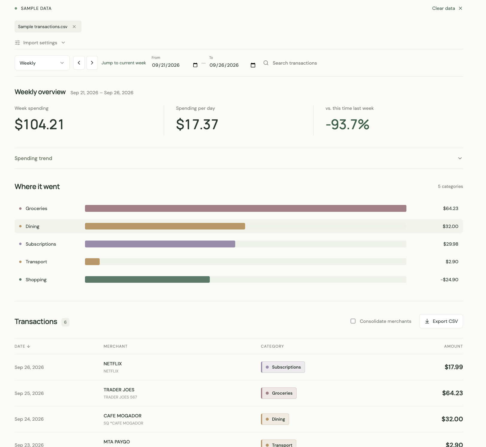

# Spending Studio

Analyze your credit card statements without data leaving your browser.



## Key features

- **Flexible CSV imports:** Upload multiple statements, map columns, and configure account labels, refunds, and exclusions. Overlapping transactions are deduplicated automatically.
- **Spending insights:** View net spending and daily averages by month, week, day, or custom range, with comparisons to equivalent previous periods.
- **Interactive trends:** Explore monthly, weekly, or daily spending and zoom into date ranges.
- **Searchable ledger:** Filter by category or merchant, consolidate merchant entries, and export filtered transactions to CSV.
- **Private by default:** Transactions are processed in browser memory. No account connections or environment variables are required.

## Get started

```sh
npm install
npm run dev
```